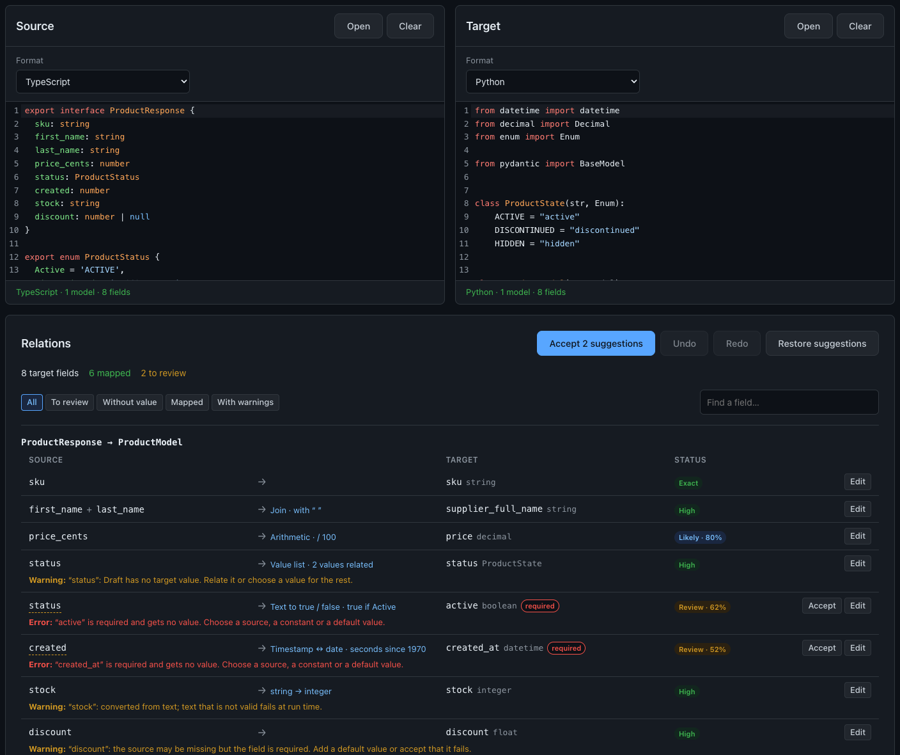

# Mapper

Client-side tool that relates two data models (classes, DTOs, JSON, schemas) field by field and generates the code that converts one into the other, **without sending anything to a server**.

- 🇬🇧 **English:** [Full documentation](./README_en.md)
- 🇪🇸 **Español:** [Documentación completa](./README_es.md)

  

## What is this repository?

Mapper helps write the mapping between two models: paste or open the source and the target in any of 21 formats (TypeScript, Python, Java, C#, Kotlin, Dart, Swift, Go, Rust, PHP, JavaScript, JSON, YAML, XML, CSV, JSON Schema, OpenAPI, GraphQL, Protocol Buffers, Prisma or a model schema), review the relations it suggests with their confidence, adjust the transformations, and copy or download the mapping code for TypeScript, JavaScript, Python, Java (also MapStruct), C# (also AutoMapper), Kotlin, Dart, Swift, Go, Rust or PHP.

It suggests, but never decides an ambiguity: relations that need a review or that have several possible sources wait for the user.

It belongs to the same family as [DataCleanr](https://github.com/RaulEstevezA/DataCleanr) and [Api2Class](https://github.com/RaulEstevezA/Api2Class), and can receive models from Api2Class and export models for DBCreate.

## Suggestions

Ideas for improvements, bugs or a format you would like Mapper to read: write to [contact.raulesteveza@gmail.com](mailto:contact.raulesteveza@gmail.com).

## Developer

**Raul Estevez**

- [Personal Website](https://raulesteveza.github.io/)
- [LinkedIn Profile](https://www.linkedin.com/in/raulesteveza/)

## License

[MIT](./LICENSE)
